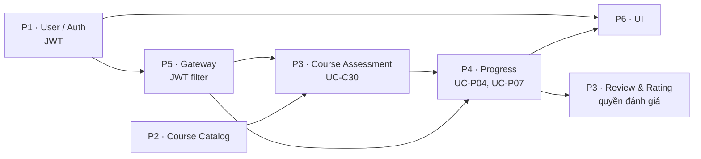

# LearnHub LMS — Kế hoạch phân công 6 thành viên & lộ trình tích hợp

> Tài liệu này trả lời 2 câu hỏi: **(1)** chia 6 người theo mô hình "mỗi người một service, người còn lại làm
> API Gateway + UI" có hợp lí không, và **(2)** mỗi người phải hoàn thành những gì **trước khi ráp** toàn bộ
> thành phần để chạy hoàn chỉnh.
>
> Liên quan: [Sơ đồ communication diagram 2 use case phức tạp nhất](./use-case-communication-diagrams.md)

---

## 1. Bối cảnh

Phạm vi dự án theo sơ đồ kiến trúc: **5 service + API Gateway + UI** = **7 workstream** chia cho **6 người**.

| Service | Port | Số UC | % khối lượng | Key Challenge | Bản chất công việc |
|---|---|---|---|---|---|
| Course Service | 8081 | 30 | 39% | 1 (UC-C30) | Nặng nhất về **số lượng** |
| User Service | 8082 | 16 | 21% | 0 | Chứa **auth/JWT** → chặn mọi service |
| Progress Service | 8084 | 11 | 14% | **5/7** | Khó nhất về **kỹ thuật**, rủi ro cao nhất |
| Review & Rating Service | 8085 | 11 | 14% | 0 | Nhẹ nhất về độ phức tạp |
| Enrollment Service | 8083 | 8 | 10% | 1 (UC-E04) | Ít UC nhất nhưng **contract bị 2 service gọi** |
| API Gateway | 8080 | — | — | — | Mỏng nhưng là cửa vào duy nhất |
| UI (client) | — | — | — | — | Client cho Student / Instructor / Admin |

### 1.1. Trạng thái repo hiện tại

| Hạng mục | Trạng thái | Việc cần làm |
|---|---|---|
| Cấu trúc | 1 app Spring Boot đơn khối (`com.example.lmsmss301`) | Tách thành Maven multi-module |
| Microservices | Chưa có (chỉ có trên sơ đồ) | Dựng 5 module service + gateway |
| Git | **Chưa phải git repo** | `git init` ngay — blocker số 1 |
| `pom.xml` | Còn dependency mẫu: `spring-ai` (GenAI/Ollama/Pinecone), `spring-boot-starter-mail`, `spring-boot-starter-session-jdbc` | **Gỡ bỏ** — không thuộc phạm vi dự án |
| Eureka / Compose | Chưa có | Dựng ở Giai đoạn 0 |
| Tài liệu | Có sơ đồ kiến trúc + 2 communication diagram | Bổ sung contract API |

---

## 2. Phương án phân công

### 2.1. Kết luận

Cách chia "mỗi người một service, người còn lại làm Gateway + UI" **hợp lí về hình thức nhưng lệch tải** và có
**3 điểm mù không ai sở hữu**. Cần 3 chỉnh sửa:

1. **San tải Course Service** — 30 UC gấp 3,75 lần Enrollment (8 UC). Tách Course thành 2 phần (Catalog / Assessment)
   cho 2 người.
2. **Không giao thêm việc cho Progress Service** — 5/7 Key Challenge đã là tải tối đa; đây là nơi dễ tắc nhất.
3. **Tách "Gateway + UI" thành 2 vai trò khác nhau về bản chất** — Gateway là hạ tầng (P5 gánh), UI + Platform là
   một vai trò riêng (P6 gánh).

Ba điểm mù phải có người chịu trách nhiệm:

| Điểm mù | Rủi ro nếu bỏ trống | Người sở hữu |
|---|---|---|
| **Contract chung** (JWT, error model, event schema) | Lệch DTO khi ráp, sửa rất tốn | P3 (contract owner) |
| **Hạ tầng dùng chung** (compose, Eureka, DB migration, seed, CI) | Không ai ráp được | P6 (Platform) |
| **Front-end** | Client cho 76 UC, dễ thành nút cổ chai mới | P6 (UI), có hỗ trợ chéo |

### 2.2. Bảng phân công chốt

| # | Vai trò | Sở hữu | UC | Trách nhiệm đặc biệt |
|---|---|---|---|---|
| **P1** | Auth & User | User Service | 16 | **Chốt JWT** — mọi service phụ thuộc, phải xong sớm nhất |
| **P2** | Course – Catalog & Media | Course: UC-C01…C13, C20…C29 | ~23 | **Nút cổ chai** — cần hỗ trợ chéo |
| **P3** | Course – Assessment & Access + Review & Rating | Course: UC-C14…C19, C30 + Review (11 UC) | 18 | **Contract owner** + UC-C30 (Key Challenge) |
| **P4** | Progress | Progress Service | 11 | Giữ đúng 1 việc — **không nhận thêm** |
| **P5** | Enrollment + API Gateway | Enrollment (8 UC) + Gateway | 8 + gw | UC-E04 là contract bị Course & Progress gọi |
| **P6** | UI + Platform / DevOps | Front-end + compose/Eureka/CI/seed | — | **Chủ trì việc ráp** toàn hệ thống |

### 2.3. Ranh giới trong Course Service (P2 vs P3)

Hai người cùng làm một service ⇒ phải chia package tách bạch ngay từ đầu, tránh conflict:

```
courservice/
├── catalog/          # P2  — course, section, lesson, material, category
│   ├── controller/   #         publish / archive / browse / search / detail
│   ├── domain/
│   └── repository/
├── assessment/       # P3  — quiz, question, access control
│   ├── controller/   #         UC-C30 access content
│   ├── domain/
│   └── repository/
└── shared/           # dùng chung — mọi thay đổi phải báo nhau
    ├── config/
    └── client/       #      EnrollmentClient, CloudinaryClient
```

**Quy tắc:** không sửa file của package người kia. Cần đổi `shared/` thì phải báo và review chéo.

### 2.4. Nếu muốn giữ nguyên phương án 5 + 1

Vẫn chạy được, chỉ cần bù chéo như sau:

| Người | Tải | Việc bù thêm |
|---|---|---|
| P-Enrollment (8 UC) | Nhẹ | Viết integration test cho Gateway |
| P-Review (11 UC, 0 KC) | Nhẹ | Nhận thêm UI màn hình Review + Course browse/detail |
| P-Course (30 UC) | **Nặng** | Được P-Platform hỗ trợ phần media/upload |
| P-Progress (5 KC) | **Nặng** | **Không nhận thêm gì** |
| P-Platform (Gateway + UI) | **Nặng** | Phải thu hẹp UI về demo flow |

---

## 3. Giai đoạn 0 — chốt cứng trước khi viết nghiệp vụ

Toàn bộ mục này phải xong **trước khi** bất kì ai code tính năng. Đây là điều kiện để 6 người làm song song mà
không giẫm chân nhau.

- [ ] **Git**: `git init`, branch `main` được bảo vệ, mỗi người một nhánh `feat/<service>`, quy ước commit.
- [ ] **Maven multi-module**: parent pom + 1 module/service (1 repo, dễ ráp, 1 lệnh `docker compose up`).
- [ ] **Gỡ dependency rác** khỏi `pom.xml`: `spring-ai-*`, `spring-boot-starter-mail`, `spring-boot-starter-session-jdbc`.
- [ ] **Contract API**: mỗi service viết `openapi.yaml` (xem §4.1).
- [ ] **JWT spec**: secret qua env `JWT_SECRET`, claims (`sub`=userId, `role`, `email`), TTL, header
      `X-User-Id` / `X-User-Role` do Gateway bơm xuống.
- [ ] **Event contract**: tên exchange/queue + payload (xem §4.2).
- [ ] **Port & DB**: chốt theo §3.1.
- [ ] **Error model**: `{ code, message, details }`, dùng thống nhất 400 / 401 / 403 / 404 / 409.
- [ ] **Quy ước chung**: id = UUID, soft delete (`deleted_at`), `created_at` / `updated_at`, phân trang.

### 3.1. Port, DB, hạ tầng

| Thành phần | Port | DB / ghi chú |
|---|---|---|
| API Gateway | 8080 | — |
| Course Service | 8081 | `course_db` |
| User Service | 8082 | `user_db` |
| Enrollment Service | 8083 | `enrollment_db` |
| Progress Service | 8084 | `progress_db` |
| Review & Rating Service | 8085 | `review_db` |
| Eureka Server | 8761 | Service discovery |
| PostgreSQL | 5432 | 5 database riêng (không share bảng) |
| RabbitMQ / Kafka | 5672 / 9092 | Event bất đồng bộ (giai đoạn sau) |
| MinIO / Cloudinary | 9000 | Lưu material |

---

## 4. Contract phải chốt trước khi ráp

### 4.1. API liên service

Đây là bảng quan trọng nhất: mọi lời gọi **xuyên service** phải được chốt trước khi ai viết code.

| Caller | Callee | Endpoint | Dùng cho |
|---|---|---|---|
| Course | Enrollment | `GET /api/v1/enrollments/check?studentId=&courseId=` | UC-C30 access control |
| Progress | Enrollment | `GET /api/v1/enrollments/check?studentId=&courseId=` | UC-P04 guard |
| Review | Enrollment | `GET /api/v1/enrollments/check?studentId=&courseId=` | UC-R01 chỉ student đã enroll |
| Progress | Course | `GET /api/v1/courses/{id}/quizzes/{quizId}` | UC-P04 lấy đề + **answer key** |
| Progress | Course | `GET /api/v1/courses/{id}/curriculum/published` | UC-P07 tính % hoàn thành |
| Course | Cloudinary | `upload` / `sign_url` | UC-C11 material, UC-C30 signed URL |
| Progress | User | `GET /api/v1/users/{id}/profile` | UC-P08 in tên trên chứng chỉ |
| Progress | Review | `POST /api/v1/reviews/permissions` | UC-P04 bước 16 — mở quyền đánh giá |
| Review | Progress | `GET /api/v1/progress/{studentId}/{courseId}` | Chỉ cho review khi đã hoàn thành |
| Gateway | tất cả service | header `X-User-Id`, `X-User-Role` | Xác thực đã qua JWT filter |

> **Lưu ý bảo mật:** `GET /courses/{id}/quizzes/{quizId}` trả cả **answer key** nên **chỉ dùng cho gọi nội bộ**
> (Progress → Course), không được expose ra Gateway cho client.

### 4.2. Event contract

| Event | Producer | Consumer | Payload | Dùng cho |
|---|---|---|---|---|
| `StudentEnrolled` | Enrollment | Progress, Review | `studentId, courseId, at` | UC-P01 khởi tạo progress |
| `StudentUnenrolled` | Enrollment | Progress, Course | `studentId, courseId, at` | UC-P11 + **xoá cache** UC-C30 |
| `LessonCompleted` | Progress | — | `studentId, lessonId, at` | UC-P02 |
| `QuizSubmitted` | Progress | — | `studentId, quizId, score, at` | UC-P04 |
| `ProgressUpdated` | Progress | — | `studentId, courseId, percent` | UC-P07 |
| `CourseCompleted` | Progress | Review | `studentId, courseId, at` | **Mở quyền đánh giá** |
| `CurriculumUpdated` | Course | Progress | `courseId, version` | UC-P10 tính lại % |

> Sơ đồ kiến trúc ghi rõ: *Stage 1 = local services + gọi REST cứng; dashed calls và infrastructure đến sau*.
> Vì vậy hãy **làm đồng bộ (REST) trước, chuyển sang async sau** — đừng để event-driven xuống cuối dự án.

---

## 5. Definition of Done trước khi ráp

### 5.1. Checklist chung — mỗi service phải đạt hết

- [ ] `Dockerfile` + entry trong `docker-compose.yml` **build và chạy được**
- [ ] DB riêng + migration tự động (`Flyway` / `Liquibase`) chạy khi start
- [ ] `GET /actuator/health` trả `UP`
- [ ] Swagger UI (`/swagger-ui.html`) để người khác tự tra contract
- [ ] Config qua **env** — không hardcode DB / JWT secret / service URL
- [ ] Đăng ký Eureka, gọi service khác qua `lb://`
- [ ] **Profile `mock`** để chạy độc lập khi service phụ thuộc chưa xong (WireMock hoặc `@Profile("mock")` bean)
- [ ] File `.http` / Postman collection cho các endpoint → ráp là test được ngay
- [ ] Script **seed data** cho demo flow
- [ ] Unit test cho logic chính, đặc biệt phần guard / quyền

### 5.2. Checklist riêng từng người

**P1 — Auth & User** ← *ưu tiên cao nhất, chặn toàn hệ thống*

- [ ] Register / Login / Logout / Reset password / Change password / View profile / Update profile
- [ ] Login trả JWT (access + refresh), hash bằng BCrypt
- [ ] Seed 3 role: `student`, `instructor`, `admin`
- [ ] Endpoint nội bộ `GET /api/v1/users/{id}` và `GET /api/v1/users/{id}/profile` (Progress & Review cần)
- [ ] Soft delete tài khoản (UC-U08, UC-U16)
- [ ] **Bàn giao JWT spec cho Gateway (P5) và test chung ngay** — rủi ro 401 hàng loạt

**P2 — Course: Catalog & Media**

- [ ] CRUD course / section / lesson / material / category
- [ ] Upload material lên Cloudinary (UC-C11…C13)
- [ ] Reorder sections & lessons (UC-C10)
- [ ] Publish / approve / unpublish / archive course (UC-C21…C24)
- [ ] Set free preview lesson (UC-C20)
- [ ] Browse / search courses + view course detail (UC-C28, UC-C29)
- [ ] **Expose `GET /courses/{id}/curriculum/published`** — P4 chờ endpoint này

**P3 — Course: Assessment & Access + Review & Rating**

- [ ] CRUD quiz / question (UC-C14…C19)
- [ ] **Expose `GET /courses/{id}/quizzes/{quizId}`** trả cả answer key (nội bộ) — P4 chờ endpoint này
- [ ] UC-C30 access content: guard free preview / instructor sở hữu / admin → gọi Enrollment check → signed URL
- [ ] Review: Create / Update / Delete review, reply, report, hide (UC-R01…R11)
- [ ] Chặn review khi chưa hoàn thành khoá (dùng `CourseCompleted` hoặc gọi Progress)
- [ ] Update aggregate rating sau mỗi lần tạo / sửa / xoá review
- [ ] **Giữ file `openapi.yaml` chung + event schema** — không ai được đổi contract mà không báo

**P4 — Progress** ← *không nhận thêm việc khác*

- [ ] `POST /api/v1/progress/quizzes/{quizId}/submit` — **idempotent theo `submissionId`**
- [ ] Guard `attemptNo <= maxAttempts` (409), chấm điểm, lưu lịch sử mọi lần làm
- [ ] Mark lesson as completed (UC-P02), save video watch position (UC-P03)
- [ ] Tính lại % hoàn thành tập trung (UC-P07) — dùng chung cho UC-P02 / P04 / P10
- [ ] Recalculate on curriculum change (UC-P10), recalculate on unenroll (UC-P11)
- [ ] Cấp chứng chỉ khi 100% + qua quiz bắt buộc (UC-P08)
- [ ] Phát event `LessonCompleted` / `QuizSubmitted` / `ProgressUpdated` / `CourseCompleted`
- [ ] **Profile `mock` cho Enrollment và Course ngay từ tuần 2** — phụ thuộc 2 service, nếu không sẽ bị chặn cứng

**P5 — Enrollment + API Gateway**

- [ ] Enroll / unenroll (UC-E01, UC-E02), View my courses (UC-E03)
- [ ] **`GET /api/v1/enrollments/check`** — contract bị Course và Progress gọi, chốt sớm nhất có thể
- [ ] Grant / revoke enrollment (Admin, UC-E06, UC-E07), View enrolled students (UC-E05)
- [ ] Phát event `StudentEnrolled` / `StudentUnenrolled` (UC-E08)
- [ ] Gateway: bảng route cho cả 5 service (qua Eureka `lb://`)
- [ ] Gateway: JWT filter → validate → bơm `X-User-Id` / `X-User-Role`, trả `401` khi token sai
- [ ] CORS cho UI, và integration test cho Gateway
- [ ] **Test chung với P1 ở Gate M3** — JWT lệch là lỗi tốn thời gian nhất

**P6 — UI + Platform / DevOps**

- [ ] `docker-compose.yml`: gateway, Eureka, 5 service, PostgreSQL, RabbitMQ, MinIO
- [ ] Script `up.sh` / `down.sh`, seed data, script reset DB
- [ ] UI: đăng nhập, danh sách khoá học, chi tiết khoá học, xem bài học, nộp quiz, xem tiến độ, đánh giá
- [ ] UI cho instructor: tạo khoá học, thêm lesson, upload material, tạo quiz, submit publish
- [ ] Sinh API client từ `openapi.yaml` — tránh gõ tay sai contract
- [ ] **Thu hẹp UI về demo flow**, không cố phủ hết 76 UC
- [ ] Chủ trì Gate M3 / M4: chạy 2 vertical slice đầu tiên

---

## 6. Lộ trình 8 tuần & cổng kiểm soát

| Tuần | Cả nhóm | Việc riêng |
|---|---|---|
| **1** | Giai đoạn 0 (§3): git + multi-module + chốt contract/JWT/port/error model | P1 dựng auth; P6 dựng compose + Eureka + Gateway skeleton; P2 dựng entity Course |
| **2** | **M1 — Contract freeze** (tag `contract-v1`) | P1 xong JWT + `GET /users/{id}`; P2 xong CRUD + `curriculum/published`; P3 xong quiz/question + `GET quizzes/{id}`; P5 xong enroll/unenroll + `/enrollments/check`; P4 xong submit idempotent (dùng mock); P6 UI login + course list |
| **3** | **M2 → Gate M3** | Ráp **vertical slice #1**: login → browse → **access content (UC-C30)** |
| **4** | **Gate M4** | Ráp **vertical slice #2**: enroll → **submit quiz (UC-P04)** → xem progress |
| **5–6** | | Review & Rating, Cloudinary/material, publish workflow, UI cho instructor |
| **7** | | Chuyển gọi đồng bộ → event async, thêm Redis cache, hardening |
| **8** | **M6 — full compose + seed + demo** | `docker compose up` 1 lệnh, demo script, tài liệu, slide |

### 6.1. Điều kiện qua cổng

| Cổng | Điều kiện pass |
|---|---|
| **M0** — Skeleton | `docker compose up` chạy được gateway + Eureka + 1 service "hello" |
| **M1** — Contract freeze | Mọi `openapi.yaml` + event schema có trong repo, tag `contract-v1`, cả nhóm review |
| **M2** — Service self-test | Mỗi service đạt **toàn bộ checklist §5.1** |
| **M3** — Vertical slice #1 | Student login → browse → xem được nội dung bài học (UC-C30) end-to-end |
| **M4** — Vertical slice #2 | Enroll → nộp quiz (UC-P04) → thấy % tiến độ cập nhật end-to-end |
| **M5** — Feature complete | 76 UC hoàn thành, Swagger đủ, test chính pass |
| **M6** — Release | 1 lệnh `docker compose up` chạy toàn bộ + seed + demo flow không lỗi |

### 6.2. Critical path & phụ thuộc



**Ai chặn ai:**

| Người bị chặn | Chờ ai | Chờ gì |
|---|---|---|
| P5, P6, mọi service | **P1** | JWT spec + endpoint `GET /users/{id}` |
| P2, P3 (UC-C30), P4 | **P5** | `GET /enrollments/check` |
| P4 | **P3** | `GET /courses/{id}/quizzes/{quizId}` (có answer key) |
| P4 | **P2** | `GET /courses/{id}/curriculum/published` |
| P3 (Review) | **P4** | Event / API `CourseCompleted` |

**Rủi ro tắc cao nhất: P2, P3 (Course) và P4 (Progress).**

---

## 7. Rủi ro & cách chặn

| # | Rủi ro | Dấu hiệu sớm | Cách chặn | Người chịu trách nhiệm |
|---|---|---|---|---|
| 1 | Không chốt contract sớm | Mỗi người tự đặt tên field khác nhau | M1 contract freeze + review cả nhóm | P3 |
| 2 | JWT lệch giữa Gateway và User | Lỗi `401` hàng loạt ở M3 | P1 + P5 test chung ngay tuần 3 | P1, P5 |
| 3 | P2 và P3 conflict trong Course Service | Sửa cùng file, merge conflict liên tục | Chia package `catalog` / `assessment`, không sửa file người kia | P2, P3 |
| 4 | Progress bị chặn vì phụ thuộc 2 service | P4 không chạy được tới tuần 3 | Profile `mock` từ tuần 2 | P4 |
| 5 | Event-driven để cuối | Tuần 7 vỡ hàng loạt | Làm REST đồng bộ trước, chuyển async sau | P6 |
| 6 | UI ôm cả 76 UC | P6 trễ, kéo cả demo | Thu hẹp về demo flow | P6 |
| 7 | Không ai ráp được vì thiếu hạ tầng | Tuần 3 vẫn chạy bằng IDE riêng lẻ | M0 xong compose + Eureka trước tuần 2 | P6 |
| 8 | Repo chưa có git | Mất code, không rollback | `git init` trong tuần 1 | P6 |

---

## 8. Quy ước làm việc chung

| Hạng mục | Quy ước |
|---|---|
| Branch | `main` (bảo vệ) ← `feat/<service>-<việc>`; không push trực tiếp lên `main` |
| Commit | `<service>: <việc>` — ví dụ `user: thêm endpoint login trả JWT` |
| Pull request | Bắt buộc ≥ 1 review chéo trước khi merge; CI phải xanh |
| Contract | Chỉ P3 được sửa `openapi.yaml` / event schema, mọi thay đổi phải thông báo nhóm |
| Nhịp họp | Daily 15 phút (đứng) + checkpoint cuối tuần đối chiếu §6 |
| Kênh | 1 kênh chung cho contract; 1 kênh riêng mỗi người để nhờ hỗ trợ |
| Định nghĩa "xong" | Theo §5.1 — service phải **chạy độc lập được**, không chỉ "code xong" |
| Nguyên tắc vàng | **Không đổi contract sau M1.** Cần đổi thì báo nhóm và cập nhật tag mới |
