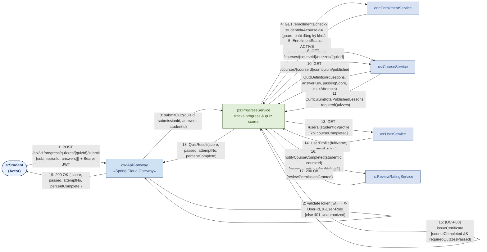

# LearnHub LMS — Sơ đồ Communication Diagram cho 2 Use Case phức tạp nhất

Tài liệu này vẽ **UML Communication Diagram** (biểu đồ giao tiếp / biểu đồ cộng tác) cho **2 use case phức tạp nhất**
của hệ thống LMS, dựa trên:

- Sơ đồ kiến trúc microservices *LearnHub LMS* (API Gateway + 5 service + infrastructure).
- Bảng `Use Case Summary` (76 use case, 7 use case gắn nhãn **Key Challenge**).
- Danh sách use case chi tiết (UC-U01…UC-R11) và cột `Key Challenge`.

> **Liên quan:** [Kế hoạch phân công 6 thành viên & lộ trình tích hợp](./team-work-plan.md) — chia vai trò theo service,
> contract API/event, và thứ tự ráp các thành phần.

---

## 1. Vì sao chọn 2 use case này?

`Use Case Summary` đánh dấu 7 use case là *Key Challenge* (`Yes`), tương ứng đúng 2 bài toán khó mà đề bài nêu ra:

| # | Service | ID | Use case | Key challenge |
|---|---------|----|----------|---------------|
| 1 | Course | **UC-C30** | Access content | Access control |
| 2 | Enrollment | UC-E04 | Check enrollment status | Access control |
| 3 | Progress | UC-P01 | Initialize progress | Progress tracking |
| 4 | Progress | UC-P02 | Mark lesson as completed | Progress tracking |
| 5 | Progress | **UC-P04** | Submit quiz & record score | Progress tracking |
| 6 | Progress | UC-P07 | Calculate completion percentage | Progress tracking |
| 7 | Progress | UC-P10 | Recalculate on curriculum change | Progress tracking |

Trong đó, **UC-C30** và **UC-P04** là 2 use case *đầu mối* (entry point) — phức tạp nhất vì:

| Tiêu chí | UC-C30 — Access content | UC-P04 — Submit quiz & record score |
|---|---|---|
| Mức chi tiết của sơ đồ | Class (controller / service / repository) | **Service** (chỉ tới ranh giới service) |
| Số participant tham gia | 13 | 7 (actor + gateway + 5 service) |
| Số message trao đổi | 28 | 19 |
| Số microservice bị gọi (không tính chính nó) | 4 (Course, Enrollment, User, Cloudinary) | 4 (Enrollment, Course, User, Review & Rating) |
| Có nhánh điều kiện (guard) | 5 | 4 |
| Có yêu cầu idempotency | – | Có (`submissionId`) |
| Có cache / xử lý bất đồng bộ | Redis cache + cache invalidation | Thông báo bất đồng bộ sang Review & Rating |
| Gắn với Key Challenge | Access control (nội dung khoá học theo trạng thái enrollment) | Progress tracking (event-driven, tính lại % hoàn thành) |
| Kéo theo use case khác | UC-E04 (Check enrollment status) | UC-P07 (Calculate completion %), UC-P08 (Completion certificate) |

> **UC-C30** là use case *đọc* tốn kém nhất: mỗi lần xem nội dung đều phải xác minh quyền truy cập (free preview → cho phép;
> instructor sở hữu khoá học / admin → cho phép; còn lại gọi Enrollment Service, `ACTIVE` → trả signed URL, ngược lại → 403)
> và bắt buộc phải đi qua cache để không "đánh sập" Enrollment Service.
>
> **UC-P04** là use case *ghi* tốn kém nhất: phải chấm điểm (cần quiz config + answer key từ Course Service), lưu lịch sử
> nhiều lần làm (idempotent), rồi tính lại tiến độ và có thể cấp chứng chỉ, đồng thời phát event bất đồng bộ.

---

## 2. Quy ước ký hiệu

| Ký hiệu | Ý nghĩa |
|---|---|
| `obj:TênLớp` | Một **object** (instance) tên `obj` thuộc lớp `TênLớp` |
| `n: thông điệp(args)` | **Message** thứ `n` theo trình tự thời gian, ghi trên đường liên kết (link) |
| `n.m` | Message lồng bên trong message `n` (kích hoạt bởi `n`) |
| `[điều kiện]` | **Guard** — message chỉ được gửi khi điều kiện đúng |
| `*[với mỗi …]` | **Iteration** — message được gửi lặp |
| `→` | Chiều gửi message (đồng bộ, sender chờ kết quả) |
| Đường nét đứt | Liên kết có thể được thay bằng event bất đồng bộ (giai đoạn sau) |

---

## 3. UC-C30 — Access content (Xem nội dung bài học, có kiểm tra quyền truy cập)

**Actor:** Student, Instructor | **Service chính:** Course Service (Port 8081)
**Tiền điều kiện:** Người dùng đã đăng nhập (Bearer JWT); khoá học ở trạng thái `PUBLISHED`.
**Hậu điều kiện:** Trả về `signedUrl` của video/tài liệu kèm `expiresAt`, hoặc `403 AccessDenied` / `404 Not Found`.

### 3.1. Các đối tượng tham gia

| Object | Lớp / Thành phần | Thuộc |
|---|---|---|
| `ACT` | Student / Instructor (actor) | Client |
| `GW` | Spring Cloud Gateway | API Gateway :8080 |
| `CS` | `LessonContentController` | Course Service :8081 |
| `AC` | `LessonAccessService` | Course Service :8081 |
| `CR` | `CourseRepository` | Course Service :8081 |
| `EC` | `EnrollmentClient` | Course Service :8081 |
| `CL` | `CloudinaryClient` | Course Service :8081 |
| `CA` | `EnrollmentCache` | Redis |
| `ENR` | `EnrollmentController` | Enrollment Service :8083 |
| `ER` | `EnrollmentRepository` | Enrollment Service :8083 |
| `CDB` | `course_db` | PostgreSQL |
| `EDB` | `enrollment_db` | PostgreSQL |
| `CDN` | Cloudinary (CDN) | External |

### 3.2. Sơ đồ

```mermaid
flowchart LR
    classDef actor fill:#E8F0FE,stroke:#1F3864,color:#1F3864,font-weight:bold;
    classDef gw    fill:#CFE2F3,stroke:#1F3864,color:#1F3864;
    classDef course fill:#DEEBF7,stroke:#1F3864,color:#1F3864;
    classDef enroll fill:#D9E2F3,stroke:#2E5395,color:#2E5395;
    classDef cache fill:#E2EFDA,stroke:#385723,color:#385723;
    classDef db    fill:#FFF2CC,stroke:#BF8F00,color:#7F6000;
    classDef ext   fill:#FCE4D6,stroke:#C55A11,color:#833C00;

    ACT(["a:Student / a:Instructor<br/>(Actor)"]):::actor

    GW["gw:ApiGateway<br/>«Spring Cloud Gateway»"]:::gw
    CS["cs:CourseService<br/>:LessonContentController"]:::course
    AC["ac:LessonAccessService"]:::course
    CR["cr:CourseRepository"]:::course
    EC["ec:EnrollmentClient"]:::course
    CL["cl:CloudinaryClient"]:::course

    CA["ca:EnrollmentCache<br/>«Redis»"]:::cache
    ENR["enr:EnrollmentService<br/>:EnrollmentController"]:::enroll
    ER["er:EnrollmentRepository"]:::enroll
    CDB[("cdb:course_db")]:::db
    EDB[("edb:enrollment_db")]:::db
    CDN("cdn:Cloudinary"):::ext

    ACT -->|"1: GET /api/v1/courses/{courseId}/lessons/{lessonId}/content<br/>(Authorization: Bearer JWT)"| GW
    GW -->|"2: validateToken(jwt) → X-User-Id, X-User-Role<br/>[else 401]"| GW
    GW -->|"3: getLessonContent(courseId, lessonId, userId, role)"| CS

    CS -->|"4: authorizeAndLoadContent(courseId, lessonId, userId, role)"| AC
    AC -->|"5: findLesson(lessonId)"| CR
    CR -->|"6: SELECT * FROM lessons WHERE id = ?"| CDB
    CDB -->|"7: LessonRow"| CR
    CR -->|"8: Lesson(courseId, status, isFreePreview, contentRef, sectionId)"| AC
    AC -->|"9: [lesson.courseId == courseId && status == PUBLISHED]<br/>[else 404]"| AC

    AC -->|"10: getEnrollmentStatus(userId, courseId)<br/>[nhánh A: bỏ qua bước 10–19 nếu isFreePreview == true]"| CA
    AC -->|"11: checkEnrollmentStatus(userId, courseId)<br/>[chỉ gọi khi cache miss / stale]"| EC
    EC -->|"12: GET /api/v1/enrollments/check?studentId={userId}&courseId={courseId}"| ENR
    ENR -->|"13: findByStudentIdAndCourseId(userId, courseId)"| ER
    ER -->|"14: SELECT status FROM enrollments WHERE ..."| EDB
    EDB -->|"15: EnrollmentRow"| ER
    ER -->|"16: Enrollment"| ENR
    ENR -->|"17: EnrollmentStatusDTO(ACTIVE / DROPPED / COMPLETED) hoặc 404"| EC
    EC -->|"18: EnrollmentStatus"| AC
    AC -->|"19: putEnrollmentStatus(userId, courseId, status, ttl = 5m)"| CA

    AC -->|"20: findCourseOwner(courseId)<br/>[nhánh B: chỉ khi role == INSTRUCTOR]"| CR
    AC -->|"21: [status == ACTIVE hoặc ownerId == userId hoặc role == ADMIN]<br/>[else 403 AccessDenied]"| AC

    AC -->|"22: generateSignedUrl(lesson.contentRef, ttl = 300s)"| CL
    CL -->|"23: sign_url(publicId, ttl)"| CDN
    CDN -->|"24: signedUrl, expiresAt"| CL
    CL -->|"25: signedUrl, expiresAt"| AC

    AC -->|"26: ContentResponse(lessonMeta, signedUrl, expiresAt)"| CS
    CS -->|"27: 200 OK"| GW
    GW -->|"28: 200 OK { contentUrl, expiresAt }"| ACT
```



### 3.3. Bảng message

| # | Từ → Đến | Thông điệp | Ghi chú |
|---|----------|-----------|---------|
| 1 | `ACT` → `GW` | `GET /api/v1/courses/{courseId}/lessons/{lessonId}/content` + `Bearer JWT` | Điểm vào duy nhất qua Gateway |
| 2 | `GW` → `GW` | `validateToken(jwt)` → `X-User-Id`, `X-User-Role` | Self-message; sai token → `401` |
| 3 | `GW` → `CS` | `getLessonContent(courseId, lessonId, userId, role)` | Route `/api/v1/courses/**` |
| 4 | `CS` → `AC` | `authorizeAndLoadContent(...)` | Tách quyết định truy cập khỏi controller |
| 5 | `AC` → `CR` | `findLesson(lessonId)` | |
| 6 | `CR` → `CDB` | `SELECT * FROM lessons WHERE id = ?` | |
| 7 | `CDB` → `CR` | `LessonRow` | |
| 8 | `CR` → `AC` | `Lesson(courseId, status, isFreePreview, contentRef, sectionId)` | |
| 9 | `AC` → `AC` | `[lesson.courseId == courseId && status == PUBLISHED]` | Guard → sai `courseId`/chưa publish ⇒ `404` |
| 10 | `AC` → `CA` | `getEnrollmentStatus(userId, courseId)` | **Nhánh A**: `isFreePreview == true` ⇒ bỏ qua 10–19, đi thẳng bước 22 |
| 11 | `AC` → `EC` | `checkEnrollmentStatus(userId, courseId)` | Chỉ gọi khi cache miss / hết TTL |
| 12 | `EC` → `ENR` | `GET /api/v1/enrollments/check?studentId=…&courseId=…` | ← chính là **UC-E04** |
| 13 | `ENR` → `ER` | `findByStudentIdAndCourseId(userId, courseId)` | |
| 14 | `ER` → `EDB` | `SELECT status FROM enrollments WHERE …` | |
| 15 | `EDB` → `ER` | `EnrollmentRow` | |
| 16 | `ER` → `ENR` | `Enrollment` | |
| 17 | `ENR` → `EC` | `EnrollmentStatusDTO(ACTIVE / DROPPED / COMPLETED)` hoặc `404` | |
| 18 | `EC` → `AC` | `EnrollmentStatus` | |
| 19 | `AC` → `CA` | `putEnrollmentStatus(userId, courseId, status, ttl = 5m)` | Ghi cache; cache bị xoá khi nhận event `StudentUnenrolled` |
| 20 | `AC` → `CR` | `findCourseOwner(courseId)` | **Nhánh B**: chỉ khi `role == INSTRUCTOR` (kiểm tra giảng viên sở hữu khoá học) |
| 21 | `AC` → `AC` | `[status == ACTIVE hoặc ownerId == userId hoặc role == ADMIN]` | Guard cuối → ngược lại ném `AccessDeniedException` ⇒ `403` |
| 22 | `AC` → `CL` | `generateSignedUrl(lesson.contentRef, ttl = 300s)` | Không trả URL trực tiếp, chỉ trả signed URL có hạn |
| 23 | `CL` → `CDN` | `sign_url(publicId, ttl)` | |
| 24 | `CDN` → `CL` | `signedUrl, expiresAt` | |
| 25 | `CL` → `AC` | `signedUrl, expiresAt` | |
| 26 | `AC` → `CS` | `ContentResponse(lessonMeta, signedUrl, expiresAt)` | |
| 27 | `CS` → `GW` | `200 OK` | |
| 28 | `GW` → `ACT` | `200 OK { contentUrl, expiresAt }` | |

### 3.4. Ghi chú thiết kế

- **Thứ tự quyết định truy cập** (theo đúng ghi chú trong `Use Case Summary`): *lesson free preview → cho phép;
  Instructor sở hữu / Admin → cho phép; còn lại gọi Enrollment Service (UC-E04), `enrollment ACTIVE` → trả signed URL,
  nếu không → `403`*.
- **Cache-first** (Redis, TTL ~5 phút) là bắt buộc vì UC-C30 là use case đọc có tần suất cao nhất; cache bị **xóa khi nhận
  event `StudentUnenrolled`** để tránh học viên đã hủy vẫn xem được nội dung.
- **Không bao giờ trả URL gốc** của Cloudinary: chỉ trả signed URL ngắn hạn (`ttl = 300s`) ⇒ giảm rủi ro chia sẻ lại link.
- **Message 12 chính là UC-E04**, vì vậy UC-C30 vừa là use case phức tạp nhất, vừa là nơi "tiêu thụ" use case Key Challenge
  của Enrollment Service.

---

## 4. UC-P04 — Submit quiz & record score (Nộp bài quiz, chấm điểm, lưu lịch sử làm bài)

**Actor:** Student | **Service chính:** Progress Service (Port 8084)
**Mức chi tiết:** **SERVICE** — chỉ vẽ tới ranh giới service, không vẽ class / repository / database nội bộ,
không vẽ Redis hay message broker (đã lược khỏi sơ đồ để tập trung vào luồng liên service).
**Tiền điều kiện:** Student đã đăng ký khoá học (`enrollment ACTIVE`); quiz đã được cấu hình trong Course Service.
**Hậu điều kiện:** Lưu lượt làm bài, cập nhật `course_progress`, (nếu đủ điều kiện) cấp chứng chỉ, mở quyền đánh giá.

### 4.1. Các đối tượng tham gia

| Object | Thành phần | Vai trò trong use case |
|---|---|---|
| `a` | Student (actor) | Khởi tạo — nộp bài quiz |
| `gw` | API Gateway (Spring Cloud Gateway, :8080) | Validate JWT, route request tới Progress Service |
| `ps` | **Progress Service** (:8084) | Service chính: chấm điểm, lưu lượt làm, tính lại tiến độ, cấp chứng chỉ |
| `enr` | **Enrollment Service** (:8083) | Guard: xác nhận student đã đăng ký khoá học |
| `cs` | **Course Service** (:8081) | Cung cấp đề quiz + answer key, và curriculum đã publish (để tính %) |
| `us` | **User Service** (:8082) | Cung cấp profile học viên để in tên trên chứng chỉ |
| `rs` | **Review & Rating Service** (:8085) | Nhận thông báo hoàn thành khoá để mở quyền đánh giá |

> `ps` được vẽ như một **làn (lane) cao**; các xử lý nội bộ của Progress Service (idempotency, chấm điểm, tính lại
> tiến độ, cấp chứng chỉ) thể hiện bằng **self-message** thay vì tách thành nhiều object lớp như bản chi tiết.

### 4.2. Sơ đồ



### 4.3. Bảng message

| # | Từ → Đến | Thông điệp | Ghi chú |
|---|----------|-----------|---------|
| 1 | `a` → `gw` | `POST /api/v1/progress/quizzes/{quizId}/submit` `{submissionId, answers[]}` + JWT | `submissionId` sinh ở client, dùng làm khoá idempotency |
| 2 | `gw` → `gw` | `validateToken(jwt)` → `X-User-Id`, `X-User-Role` | Self-message; sai token → `401` |
| 3 | `gw` → `ps` | `submitQuiz(quizId, submissionId, answers, studentId)` | Route `/api/v1/progress/**` |
| 4 | `ps` → `enr` | `GET /enrollments/check?studentId=&courseId=` | Guard: chỉ student đã enroll mới được nộp |
| 5 | `enr` → `ps` | `EnrollmentStatus = ACTIVE` | Ngược lại → `403 NotEnrolled` |
| 6 | `ps` → `cs` | `GET /courses/{courseId}/quizzes/{quizId}` | Progress Service **không** giữ đề/đáp án |
| 7 | `cs` → `ps` | `QuizDefinition(questions, answerKey, points, passingScore, maxAttempts, isRequired)` | Một nguồn dữ liệu duy nhất cho quiz |
| 8 | `ps` → `ps` | `[idempotent] findBySubmissionId(submissionId)` | Đã có ⇒ trả kết quả đã lưu, bỏ qua bước 9–12 |
| 9 | `ps` → `ps` | `[attemptNo ≤ maxAttempts]` `[else 409]`; `grade()` + `saveAttempt()` | Guard số lần làm + chấm điểm + lưu lượt làm |
| 10 | `ps` → `cs` | `GET /courses/{courseId}/curriculum/published` | Lấy mẫu số để tính % hoàn thành |
| 11 | `cs` → `ps` | `Curriculum(totalPublishedLessons, requiredQuizzes)` | |
| 12 | `ps` → `ps` | `[UC-P07] recalculate` → `upsertCourseProgress(percent, courseCompleted)` | Tính lại tiến độ tập trung (dùng chung với UC-P02, UC-P10) |
| 13 | `ps` → `us` | `GET /users/{studentId}/profile` | Chỉ khi khoá học đã hoàn thành |
| 14 | `us` → `ps` | `UserProfile(fullName, email, roles)` | Dữ liệu để in tên trên chứng chỉ |
| 15 | `ps` → `ps` | `[UC-P08] issueCertificate(studentId, courseId)` | Guard: `courseCompleted && requiredQuizzesPassed` |
| 16 | `ps` → `rs` | `notifyCourseCompleted(studentId, courseId)` | **Async** — mở quyền đánh giá (UC-R01) cho học viên đã hoàn thành |
| 17 | `rs` → `ps` | `200 OK (reviewPermissionGranted)` | |
| 18 | `ps` → `gw` | `QuizResult(score, passed, attemptNo, percentComplete)` | |
| 19 | `gw` → `a` | `200 OK { score, passed, attemptNo, percentComplete }` | |

### 4.4. Ghi chú thiết kế

- **Ba service nằm trong luồng chính**: `Progress` (điều phối) gọi `Enrollment` (bước 4–5, guard quyền nộp bài) và
  `Course` (bước 6–7 lấy đề + đáp án, bước 10–11 lấy curriculum để tính %).
- **User Service (13–14)** chỉ được gọi khi khoá học **đã hoàn thành**, để lấy tên học viên in lên chứng chỉ — đây là
  điểm chạm duy nhất giữa UC-P04 và User Service.
- **Review & Rating Service (16–17)**: sau khi hoàn thành khoá, Progress Service thông báo để service này **mở quyền
  đánh giá** cho học viên (Review & Rating chỉ cho phép học viên đã học xong đánh giá). Lời gọi mang tính bất đồng bộ,
  trong hệ thống thật đi qua message broker (`CourseCompleted`).
- **Idempotency (bước 8)** là điểm quan trọng nhất: `submissionId` do client sinh, kiểm tra trước khi chấm điểm ⇒ nộp
  lại do timeout/mạng yếu **không** tạo thêm lượt làm và **không** cộng dồn điểm.
- **Answer key không nằm ở Progress Service** (bước 6–7): buộc phải hỏi Course Service, đảm bảo single source of truth.
- **Tiến độ được tính lại tập trung** (bước 9–12 trong nội bộ Progress Service) ⇒ UC-P02 (Mark lesson as completed),
  UC-P04 (Submit quiz) và UC-P10 (Recalculate on curriculum change) dùng chung một thuật toán.
- **Đã lược khỏi sơ đồ** so với bản chi tiết: `QuizAttemptRepository`, `GradingService`, `ProgressCalculator`,
  `CourseProgressRepository`, `CertificateService`, `course_db`, `progress_db`, Redis và message broker. Các bước
  tương ứng được gộp vào self-message 8, 9, 12, 15 của `ps`.

## 5. So sánh nhanh 2 sơ đồ

| Khía cạnh | UC-C30 (Access content) | UC-P04 (Submit quiz & record score) |
|---|---|---|
| Bản chất | Read path, nhiều tầng guard | Write path, nhiều bước ghi + tính toán |
| Điểm nghẽn cần chú ý | Gọi Enrollment Service cho mọi lượt xem ⇒ phải có cache | Chấm điểm + tính lại tiến độ ⇒ phải idempotent |
| Cơ chế bảo vệ | Guard `[ACTIVE / owner / ADMIN]` + signed URL ngắn hạn | Guard `[attemptNo <= maxAttempts]` + `submissionId` |
| Phụ thuộc liên service | Course → Enrollment (UC-E04) | Progress → Enrollment, Progress → Course (UC-P07, UC-P08) |
| Xử lý bất đồng bộ | Xoá cache khi nhận `StudentUnenrolled` | Thông báo `CourseCompleted` sang Review & Rating (async) |

---

## 6. Cách mở / render lại sơ đồ

Cùng một sơ đồ được lưu ở **3 định dạng** để dùng cho các mục đích khác nhau:

| Định dạng | Vị trí | Dùng khi nào |
|---|---|---|
| **Mermaid** | ngay trong file `.md` này | Xem nhanh, nhúng vào Markdown/GitHub |
| **Draw.io** | [`docs/diagrams/drawio/`](./diagrams/drawio/) | Cần **chỉnh sửa / kéo thả / trình bày** |
| **PlantUML** | [`docs/diagrams/`](./diagrams/) + [`rendered/`](./diagrams/rendered/) | Xuất ảnh hàng loạt, version-control bằng text |

### Mermaid (xem trực tiếp trong VS Code)

Mở file này và dùng **Markdown Preview** (`Ctrl+Shift+V`) — VS Code render Mermaid sẵn, không cần cài gì thêm.

### Draw.io (`*.drawio`)

| File | Use case |
|---|---|
| `drawio/uc-p04-submit-quiz.drawio` | UC-P04 — Submit quiz & record score (7 participant, 19 message, **mức service**) |

> UC-C30 chưa có bản `.drawio` trong repo (vẫn có bản Mermaid ở mục 3.2 và bản PlantUML/ảnh ở mục 6).

Mở bằng một trong các cách sau:

- **VS Code**: cài extension *Draw.io Integration* (`hediet.vscode-drawio`) rồi mở trực tiếp file `.drawio`.
- **Web**: vào <https://app.diagrams.net> → *Open Existing Diagram* → chọn file.
- **Dán mã**: mở một diagram bất kỳ → *Extras ▸ Edit Diagram…* → dán toàn bộ nội dung file `.drawio`.

Cấu trúc file dùng đúng chuẩn `mxGraphModel`. UC-C30 vẽ ở mức class (có **database** dạng `shape=cylinder3`);
UC-P04 vẽ ở mức **service** (actor + gateway + 5 service, không có DB/repository). Cả hai dùng **edge** mang số thứ
tự message (`endArrow=open;endFill=0`) — mỗi message trong bảng ở mục 3.3 / 4.3 đều có một mũi tên tương ứng, và
mỗi sơ đồ có kèm một ô **note** ghi chú quy ước + các nhánh điều kiện.
Mũi tên **màu tím** là self-message (xử lý nội bộ / guard như `validateToken`, `[attemptNo ≤ maxAttempts]`).

### PlantUML (xuất ảnh)

Nguồn PlantUML nằm trong [`docs/diagrams/`](./diagrams/) và ảnh đã render sẵn trong
[`docs/diagrams/rendered/`](./diagrams/rendered/):

| File nguồn | Ảnh | Mức chi tiết |
|---|---|---|
| `uc-c30-access-content.puml` | `rendered/uc-c30-access-content.svg` / `.png` | class |
| `uc-p04-submit-quiz.puml` | `rendered/uc-p04-submit-quiz.svg` / `.png` | **service** |

```bash
java -jar plantuml.jar -charset UTF-8 -tsvg -o ./rendered docs/diagrams/*.puml
```

> PlantUML cần **Graphviz** để bố cục sơ đồ object. Nếu máy chưa có, cài `graphviz` hoặc trỏ tới binary bằng
> `java -DGRAPHVIZ_DOT=/đường/dẫn/dot -jar plantuml.jar …`.
